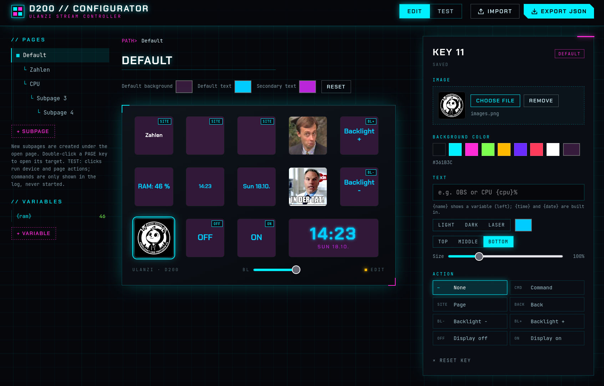
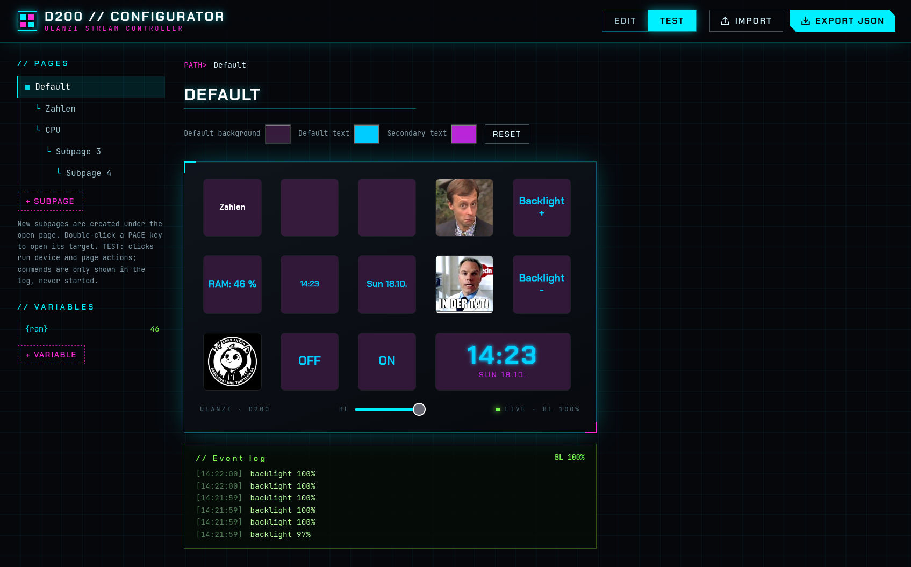

# ulanzi_d200_tooling

Use the Ulanzi D200 as a standalone control panel with your own software, without the
vendor app. A small Rust service, `deckd`, runs on the device and draws the 14 key
windows; a Linux host (`deck`) configures the keys, runs their actions and serves a
web configurator.

This project is not affiliated with Ulanzi. It replaces the vendor app at runtime and
changes nothing outside `/userdata/d200` on the device; `adb reboot` restores the stock UI.

## Features

- **No firmware changes**: the vendor firmware stays untouched. `deckd` runs from `/userdata/d200` and
  the stock app is only stopped while it runs; `adb reboot` brings the original UI back.
- **Custom key images**: set an image or icon per key (file picker or drag and drop), with
  optional text on top (position, size, colour).
- **Colours**: background and text colours per key, with page-wide defaults you can change in
  one place; a key can be reset to follow the default again.
- **Subpages**: build a page tree with `page` and `back` keys, move pages around by drag and
  drop.
- **Actions**: run shell commands, change the backlight, switch the display off and on.
- **Live values**: show the output of shell commands on keys (e.g. `CPU {cpu}%`, polled at an
  interval you choose), plus a built-in clock and date.
- **Web configurator**: edit and test everything in the browser, changes are saved and shown on
  the device immediately; import and export the configuration as JSON. The UI also works
  without a device.
- **Runs unattended**: `deck serve` brings the device up via `adb`, reconnects after replugging
  and reloads the configuration when it changes; an optional systemd user unit starts it at
  login.
- **Local by default**: the web UI listens on `127.0.0.1` only, because it can configure commands.

## Preview

The web configurator: edit a key (image, colours, text, action) and test it live.





## Layout

| Folder | Content |
|---|---|
| `device/` | Rust crate for the device: `deckd`, `hello`, `calibrate` |
| `host/` | Python package `d200-deck` with the `deck` command and the web UI |
| `docs/` | `protocol.md` (deckd protocol), `web-api.md` (HTTP API), `hardware.md` (display, keys, layout) |
| `img/` | Screenshots for this README |

## Installation

Requirements: `adb`, Rust (`cargo`, ideally via `rustup`) and `uv`. Then:

```sh
./install.sh        # builds deckd for the D200, installs the `deck` command + shell completion
deck serve          # starts deckd on the device via adb, draws the keys, serves the web UI
```

Open <http://127.0.0.1:7280/> to configure the keys. `deck serve` stops the vendor app,
installs and starts `deckd` on the device and reconnects after replugging. Nothing
outside `/userdata/d200` is changed on the device; `adb reboot` restores the stock UI.
To start it at login, enable the systemd user unit written by `install.sh`. See
`host/README.md` for the CLI, configuration format and autostart.

## Security

The web configurator can define shell commands, so treat access to it like a shell
on the host. There is **no authentication yet**; a password feature is planned.
Until then:

- **Keep the web UI on `127.0.0.1`** (the default). Anyone who can open it can run
  commands as the user running `deck serve`: key commands run on a key press, and
  variable commands (`sh -c`) run on their own as soon as they are saved. Do not use
  `--web 0.0.0.0:...` on an untrusted network; `deck serve` logs a warning when you do.
- **Other local users** of the same machine can reach `127.0.0.1:7280` as well. Do not run
  `deck serve` on a shared machine. For remote access use an SSH tunnel instead of
  exposing the port.
- **Websites cannot reach it**: the API only answers requests with the expected `Host`
  header (protects against DNS rebinding) and requires the header `X-Deck-Request: 1` on
  changing requests (see `docs/web-api.md`).
- **The TEST tab never runs commands**; it only logs them. Device and page actions do run.
- **Protect the configuration**: `$XDG_CONFIG_HOME/deck/config.json` contains your commands;
  whoever can write it can run commands. Keep it writable only by you.
- **Do not put secrets into commands or key texts**: keys, variable values and the
  configuration are visible in the UI and on the device screen.
- **Device side**: `deckd` listens on `127.0.0.1:7200` on the D200 only and is reached through
  `adb forward`, which makes the port available to local users of the host. `deckd` has no
  authentication either, so anyone with access to that port can draw on the screen. `adb`
  itself gives a root shell on the stock firmware: keep the device physically controlled.

Planned: a password for the web UI and API. Until it exists, do not expose the UI beyond
your own machine. Please report security problems privately to the repository owner rather
than in a public issue.

## Development

- Device code: `device/` (Cargo, target ARMv7 musl via `.cargo/config.toml`).
- Host client: see `host/README.md`.

## Tests

```sh
cd device && cargo test --target x86_64-unknown-linux-gnu
cd device && cargo build --target x86_64-unknown-linux-gnu --bin deckd   # for the E2E test
cd host && uv run pytest && uv run ruff check . && uv run mypy
```

## License

MIT, see `LICENSE`.
